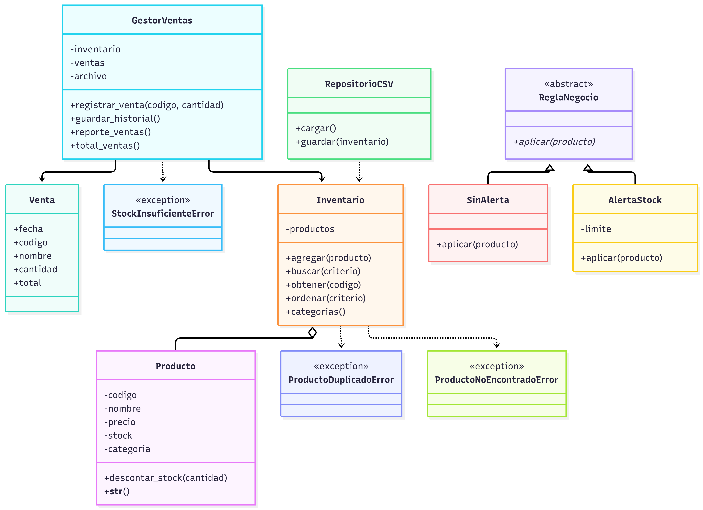
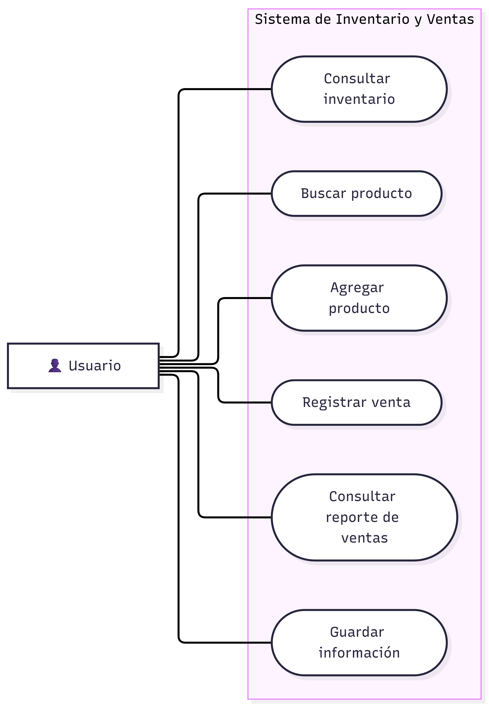
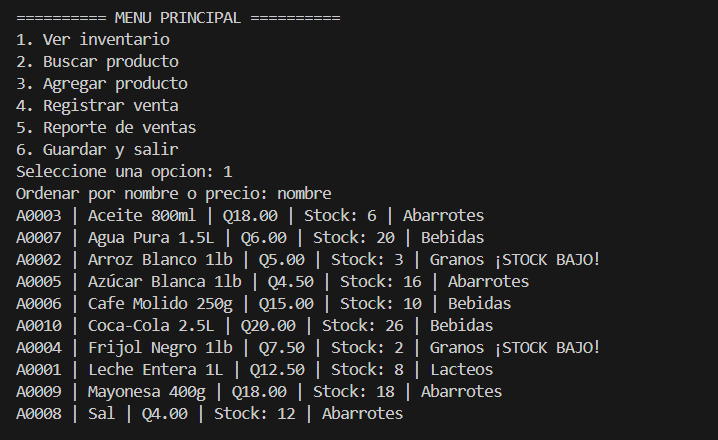

# Sistema de Inventario y Ventas con Programación Orientada a Objetos

**Universidad:** Universidad Mariano Gálvez de Guatemala  
**Campus:** Boca del Monte  
**Facultad:** Ingeniería en Sistemas  
**Curso:** Algoritmos  
**Estudiante:** Alessandra Pamela Contreras Ramírez  
**Carné:** 7691-26-19524  
**Ciclo académico:** 2026

## Descripción del proyecto

Mi proyecto consiste en el desarrollo de un Sistema de Inventario y Ventas utilizando Python y los principios de la Programación Orientada a Objetos (POO).

El sistema permite administrar productos, consultar existencias, buscar artículos, registrar ventas y guardar información mediante archivos CSV y TXT.

## Objetivo general

Desarrollar un sistema de inventario y ventas aplicando los conceptos fundamentales de la Programación Orientada a Objetos, con el propósito de organizar mejor el código y facilitar su mantenimiento.

## Tema de negocio y regla especial

El tema de negocio que elegí fue un sistema para administrar el inventario y las ventas de una tienda de productos de consumo diario.

Como regla especial, decidí implementar una **alerta de stock bajo**, que permite identificar cuando las existencias de un producto llegan a un límite establecido.

Para ello, utilicé las clases `ReglaNegocio`, `SinAlerta` y `AlertaStock`, aplicando los conceptos de herencia y polimorfismo.

## Funcionalidades principales

- Visualizar los productos registrados.
- Buscar productos dentro del inventario.
- Agregar nuevos productos.
- Registrar ventas y actualizar las existencias.
- Consultar el reporte de ventas.
- Guardar la información del inventario en un archivo CSV.
- Registrar el historial de ventas en un archivo TXT.
- Mostrar alertas cuando las existencias sean bajas.

## Conceptos de Programación Orientada a Objetos

**Clases y objetos:** Utilicé clases para representar productos, inventarios y ventas.

**Encapsulamiento:** Organicé los atributos y métodos dentro de las clases para administrar la información del sistema.

**Herencia:** Las clases `SinAlerta` y `AlertaStock` heredan de la clase abstracta `ReglaNegocio`.

**Polimorfismo:** Las clases derivadas implementan el método `aplicar()` con comportamientos diferentes.

**Abstracción:** Utilicé una clase abstracta para establecer una estructura común para las reglas del sistema.

**Excepciones personalizadas:** Implementé excepciones para manejar productos duplicados, productos inexistentes y existencias insuficientes.

## Estructura del proyecto

Los principales archivos y carpetas del proyecto son:

| Archivo o carpeta | Descripción |
|---|---|
| `main_poo.py` | Ejecuta el menú principal del sistema. |
| `inventario/modelos.py` | Contiene las clases Producto y Venta. |
| `inventario/inventario.py` | Administra los productos registrados. |
| `inventario/ventas.py` | Gestiona las ventas y su historial. |
| `inventario/repositorio.py` | Permite cargar y guardar los datos del inventario. |
| `inventario/reglas.py` | Contiene las reglas de negocio. |
| `inventario/excepciones.py` | Define las excepciones personalizadas. |
| `inventario.csv` | Almacena los productos registrados. |
| `bitacora.txt` | Guarda el historial de ventas. |
| `docs/` | Contiene los diagramas UML y la reflexión final. |
| `evidencias/` | Contiene las capturas de las pruebas de ejecución. |
| `README.md` | Presenta la información y las instrucciones del proyecto. |

## Descripción de las clases

- **Producto:** Representa un producto con su código, nombre, precio, existencias y categoría.
- **Venta:** Representa la información de una venta realizada.
- **Inventario:** Permite agregar, buscar, consultar y ordenar productos.
- **GestorVentas:** Registra las ventas, actualiza las existencias y administra el historial.
- **RepositorioCSV:** Se encarga de cargar y guardar la información del inventario.
- **ReglaNegocio:** Clase abstracta que establece el método común para las reglas.
- **SinAlerta:** Implementa una regla sin generar alertas de stock.
- **AlertaStock:** Permite identificar productos con existencias bajas.
- **ProductoDuplicadoError:** Maneja el error al intentar agregar un código duplicado.
- **ProductoNoEncontradoError:** Maneja el error cuando no se encuentra un producto.
- **StockInsuficienteError:** Maneja el error cuando no hay existencias suficientes para una venta.

## Ejecución del proyecto

Para ejecutar el sistema:

1. Tener Python instalado en la computadora.
2. Descargar o clonar el repositorio.
3. Abrir la carpeta del proyecto en Visual Studio Code.
4. Abrir una terminal dentro de la carpeta principal.
5. Ejecutar el siguiente comando:

```bash
python main_poo.py
```

Al ejecutar el programa, se mostrará el menú principal con las opciones disponibles para administrar el inventario y registrar ventas.

## Diagramas UML

### Diagrama de clases

Este diagrama representa las clases utilizadas en el sistema y las relaciones entre ellas.



**Archivo fuente:** [Diagrama de clases](docs/diagrama_clases.md)

### Diagrama de casos de uso

Este diagrama representa las principales funciones que puede realizar el usuario dentro del sistema.



**Archivo fuente:** [Diagrama de casos de uso](docs/diagrama_casos_uso.md)

## Ejemplo de uso del sistema

La siguiente imagen muestra un ejemplo de ejecución del Sistema de Inventario y Ventas.



## Pruebas del sistema

Realicé pruebas para verificar el funcionamiento de los diferentes componentes del proyecto.

Los archivos de prueba utilizados son:

- `prueba_inventario.py`
- `prueba_ventas.py`
- `prueba_repositorio.py`
- `prueba_historial.py`
- `prueba_polimorfismo.py`

Las pruebas permiten comprobar el funcionamiento del inventario, el registro de ventas, el almacenamiento de información y la aplicación de herencia y polimorfismo.

También se incluyen evidencias del manejo de errores mediante excepciones personalizadas.

### Evidencias de ejecución

Las capturas de las pruebas se encuentran en la carpeta [evidencias](evidencias/).

## Reflexión final

Durante el desarrollo de este proyecto comprendí mejor la importancia de la Programación Orientada a Objetos y cómo permite organizar un programa mediante clases y métodos.

Uno de mis principales aprendizajes fue transformar un sistema que inicialmente utilizaba funciones en una estructura orientada a objetos, separando las responsabilidades de cada componente.

También aprendí a utilizar la herencia, el polimorfismo, la abstracción y las excepciones personalizadas para mejorar la organización y el funcionamiento del sistema.

Este proyecto me permitió fortalecer mis conocimientos de Python y aplicar los conceptos aprendidos en clase a un programa práctico.

**Documento completo:** [Leer reflexión final](docs/reflexion_final.docx)

## Control de versiones

Durante el desarrollo utilicé Git y GitHub para registrar los avances y las modificaciones realizadas en el proyecto.

El historial de commits permite observar los cambios efectuados durante la refactorización del sistema.

## Herramientas utilizadas

- Python
- Visual Studio Code
- PowerShell
- Git y GitHub
- ChatGPT como herramienta de apoyo para comprender conceptos y revisar errores.
